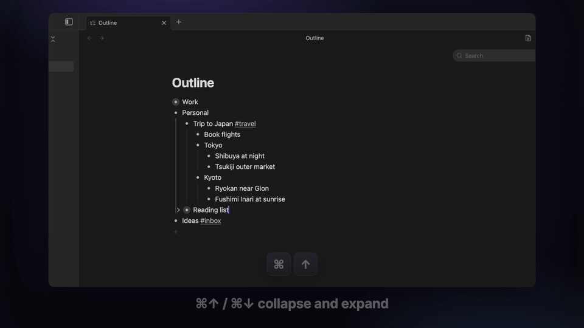

# Flow Outliner (Obsidian plugin)



▶ Full demo video (1080p, ~48 s): [media/flow-outliner-demo.mp4](media/flow-outliner-demo.mp4)

A Workflowy-style outliner inside Obsidian. You get one endless outline, you can zoom into any bullet, and everything is driven from the keyboard. The outline is still a **plain Markdown list** in your vault, so links, backlinks, search, sync and Git keep working.

## How it was built

This is a clean-room reimplementation of Workflowy's *behaviour*, not of its code. I wrote down how Workflowy behaves (data model, keyboard map, zoom/search semantics) and built it again on Obsidian's API. I did not decompile or copy any Workflowy code. The features listed below were the spec:

| Workflowy | Here |
|---|---|
| Everything is a bullet, infinite nesting | A Markdown file of nested `- ` items (tabs). Notes are indented continuation lines. |
| Click a bullet to zoom; breadcrumbs | Same. Zoom and collapse state are remembered per file. Titles are editable when zoomed. |
| Collapse / expand (ring around collapsed bullets) | Cmd-↑ / Cmd-↓, or the arrow that appears on hover |
| Complete (strike-through), show/hide completed | Cmd-Enter → saved as `- [x]`. Toggle with the ✓✓ header button |
| Notes under items | Shift-Enter. Shown dimmed and clamped to 3 lines |
| Live search filter (keeps ancestors) | Cmd-F. Accent-insensitive, `-exclude`, `"exact phrase"`, `is:complete` |
| Tags `#x` / `@x` are clickable filters | Same. `[[` and `#` autocomplete from your vault |
| Jump to any item | Cmd-K |
| Drag bullets to move | Same, with a drop indicator. Drop to the right to nest |
| Multi-select | Esc, then Shift-↑/↓. Then Tab, Shift-Tab, Cmd-Enter, Backspace, Cmd-C/X, Cmd-Shift-↑/↓ |
| Paste many lines → many bullets | Same, including Markdown lists and indented plain text |
| Undo | Cmd-Z / Cmd-Shift-Z (own undo stack, typing grouped in bursts) |

Obsidian-specific extras: `[[wikilinks]]` with hover preview (links open in a new tab so the outline stays put), `- [ ]` checkboxes (Cmd-L), quick capture command, Markdown/outline toggle per note.

## Using it

* Ribbon icon (list-tree) or command **Open home outline** opens `Outline.md`. It's created with a short tutorial the first time.
* Any note with `flow-outliner: true` in its frontmatter opens as an outline automatically.
* Command **Toggle outline / Markdown view** switches any note between the two views.
* Opening a note in the outline view never rewrites it. The file is only rewritten (normalised to `- ` bullets with tab indentation) once you edit it there. Notes that aren't pure outlines (headings, paragraphs) show a warning banner first.
* Bind **Quick capture to home outline** to a global hotkey in Settings → Hotkeys to send a thought to the top of your outline from anywhere.

Full shortcut list: Settings → Flow Outliner.

## Development

```sh
npm install
npm test          # model / Markdown round-trip tests (node --test)
npm run build     # typecheck + bundle to main.js
```

Install by copying `main.js`, `manifest.json` and `styles.css` to `<vault>/.obsidian/plugins/flow-outliner/`.

Source layout: `src/model.ts` (tree, Markdown parser/serialiser, search; pure and tested), `src/view.ts` (the outline view: keyed DOM reconciliation, editing, keyboard, drag, selection, undo), `src/inline.ts` (inline rendering + caret helpers), `src/suggest.ts` (`[[`/`#` autocomplete), `src/main.ts` (plugin, commands, settings).

Performance: a 5,700-item outline redraws in ~10–20 ms per edit, because unchanged rows keep their DOM.

## Demo video

`demo/` is a [Remotion](https://www.remotion.dev) project. The footage isn't a mock-up: `demo/capture/capture.py` drives a real Obsidian window (vault `Flow-Demo`) through the Obsidian CLI, sends real key and mouse events through the Chrome DevTools Protocol, and screenshots every step. Remotion then adds the camera moves, cursor, caret, keycaps and captions.

```sh
# from the repo root; Obsidian must be running with the Flow-Demo vault open
(cd demo && npm install)
demo/capture/reset_demo_vault.sh <path-to-Flow-Demo-vault>
python3 demo/capture/capture.py <path-to-Flow-Demo-vault> /tmp/capture
cp -R /tmp/capture/frames /tmp/capture/shots.json demo/public/
(cd demo && npm run render)    # -> demo/out/flow-outliner-demo.mp4
```

## Not (yet) there

Mirrors, boards/kanban layout, dates, sharing, and a calendar view. The mobile toolbar (indent / move / complete / zoom) exists but hasn't been tried on a phone. Collapse/zoom state is keyed by item text, so editing a file *outside* the outline view can forget which items were collapsed.
